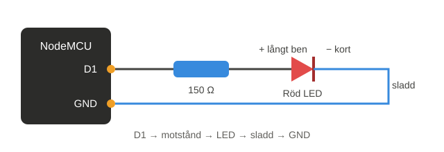

# Få en lampa att blinka med kod

## Översikt

> **Kort sagt:** Vi skriver lite kod som får en lampa att tändas och släckas, om och om igen.

Här lär du dig att få en liten lampa att blinka med hjälp av kod.
Du behöver ingen förkunskap.


**Det här behövs:**
- 1 NodeMCU-kort (en pytteliten dator)
- 1 röd lampa (LED)
- 1 motstånd (150 Ω)
- 1 sladd och ett kopplingsdäck
- En USB-kabel och en dator med programmet Arduino IDE

## Mikroprocessor – kortet vi använder

> **Kort sagt:** Kortet är en liten dator som kan slå på och stänga av ström när koden säger det.

Kortet heter **NodeMCU** och har chippet **ESP8266**.
Tänk på det som en **strömbrytare som styrs av kod**.
Det kan slå på och stänga av ström, och det har WiFi.


**Så gör du kortet redo i Arduino IDE:**
1. Öppna **Preferences** och klistra in den här länken under *Additional boards manager URLs*:
   `http://arduino.esp8266.com/stable/package_esp8266com_index.json`
2. Öppna **Boards Manager**, sök på `esp8266` och klicka **Install**.
3. Välj kortet **NodeMCU 1.0 (ESP-12E Module)**.

## Koppling

> **Kort sagt:** Strömmen går ut från kortet, genom motståndet (en broms för strömmen) och lampan, och tillbaka till kortet.

Strömmen måste kunna gå **ett helt varv**, som vatten i ett rör som går runt.



- **Motståndet** är en **broms**. Utan den går lampan sönder.
- Lampan har ett **långt ben** och ett **kort ben**.
  Det långa benet ska vara mot strömmen (D1).
  Sitter lampan åt fel håll lyser den inte.
- På kopplingsdäcket har alla hål i **samma rad** kontakt med varandra.

## Två basfunktionerna i Arduino

> **Kort sagt:** `setup` görs en gång vid start. `loop` görs om och om igen.

Alla Arduino-program har två delar:

```cpp
void setup() { }   // görs EN gång, när kortet startar
void loop()  { }   // görs OM OCH OM IGEN, hela tiden
```

Tänk dig en vanlig dag:
- **setup** är när du vaknar och gör dig redo. Det gör du en gång.
- **loop** är något du gör om och om igen.

## Ställ in pinnarna (portinitialisering)

> **Kort sagt:** Innan vi använder en pinne berättar vi vad den ska göra. Här ska D1 skicka ut ström.

Kortet har små metallstift som heter **pinnar**.
Innan vi använder en pinne måste vi säga vad den ska göra:

```cpp
pinMode(D1, OUTPUT);   // "Pinne D1, du ska skicka ut ström"
```

| Ord | Betyder |
|---|---|
| `OUTPUT` | pinnen **skickar ut** ström, till exempel till en lampa |
| `INPUT` | pinnen **lyssnar**, till exempel på en knapp |

## Kod med förklaringar

> **Kort sagt:** HIGH tänder lampan, LOW släcker den, och delay väntar. Det upprepas, så lampan blinkar.

Hela koden finns i filen [blink.ino](blink.ino).

```cpp
void setup() {
  pinMode(D1, OUTPUT);     // D1 ska skicka ut ström
  Serial.begin(115200);    // kortet får prata med datorn
}

void loop() {
  digitalWrite(D1, HIGH);        // ström PÅ  → lampan tänds
  Serial.println("Lampa på");    // skriv till datorn
  delay(500);                    // vänta en halv sekund

  digitalWrite(D1, LOW);         // ström AV  → lampan släcks
  Serial.println("Lampa av");    // skriv till datorn
  delay(500);                    // vänta en halv sekund
}
```

**Förklaring:**
| Kod | Betyder |
|---|---|
| `HIGH` | ström **på** |
| `LOW` | ström **av** |
| `delay(500)` | **vänta** 500 millisekunder (en halv sekund) |

Eftersom koden ligger i **loop** händer det om och om igen. Därför **blinkar** lampan.

Kortet skriver också till datorn. Öppna **Serial Monitor** och välj **115200**:


## Om något krånglar

> **Kort sagt:** Lyser lampan inte är det oftast för att den sitter åt fel håll.

| Problem | Prova det här |
|---|---|
| Lampan lyser inte | **Vänd** på lampan |
| En vit lampa lyser inte | Använd en **röd** lampa, den behöver mindre ström |
| Felet `bad CPU type` på Mac | Skriv i Terminal: `softwareupdate --install-rosetta --agree-to-license` |
