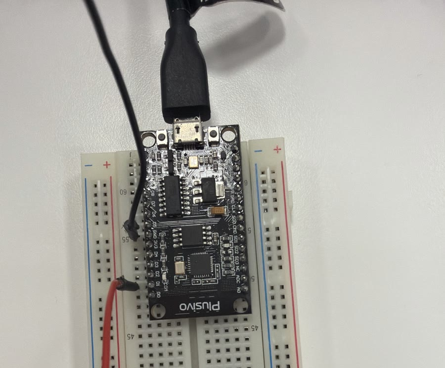

# Blinka en LED med NodeMCU

## Översikt
Vi får en röd LED att blinka med ett NodeMCU-kort och lite kod.


## Mikroprocessor
**NodeMCU (Plusivo)** med chippet **ESP8266**. Det har inbyggt WiFi.



Inställningar i Arduino IDE:
- **Preferences → Additional boards manager URLs:**
  `http://arduino.esp8266.com/stable/package_esp8266com_index.json`
- **Boards Manager:** installera `esp8266`
- **Board:** `NodeMCU 1.0 (ESP-12E Module)`

## Koppling
Det behövs: 1 röd LED, 1 motstånd (150 Ω) och 1 sladd.


- LED:ns **långa ben (+)** mot motståndet och D1
- LED:ns **korta ben (−)** mot GND
- Delar i **samma rad** på kopplingsdäcket har kontakt

## Två basfunktionerna i Arduino
```cpp
void setup() { }   // körs EN gång vid start
void loop()  { }   // körs om och om igen
```

## Portinitialisering
Innan en pinne används måste man säga vad den ska göra:
```cpp
pinMode(D1, OUTPUT);
```

| Läge | Betyder |
|---|---|
| `OUTPUT` | skickar ut ström (t.ex. till en LED) |
| `INPUT` | läser in (t.ex. en knapp) |
| `INPUT_PULLUP` | läser in, är HIGH som standard |

## Kod med förklaringar
Hela koden finns i [blink.ino](blink.ino).

```cpp
const int LED = D1;    // pinnen där LED:n sitter
const int TID = 500;   // en halv sekund

void setup() {
  pinMode(LED, OUTPUT);   // D1 ska skicka ut ström
  Serial.begin(115200);   // kontakt med datorn
}

void loop() {
  digitalWrite(LED, HIGH);      // LED tänds
  Serial.println("Lampa på");
  delay(TID);                   // vänta

  digitalWrite(LED, LOW);       // LED släcks
  Serial.println("Lampa av");
  delay(TID);                   // vänta
}
```

Resultat i Serial Monitor (115200 baud):


## Vanliga problem
| Problem | Lösning |
|---|---|
| `bad CPU type in executable` (Mac) | Kör `softwareupdate --install-rosetta --agree-to-license` |
| LED:n lyser inte | Vänd på LED:n |
| Vit LED lyser inte | Använd en röd LED, den behöver mindre ström |
| Inbyggda lampan gör tvärtom | På NodeMCU är `LOW` = på för den inbyggda lampan |
