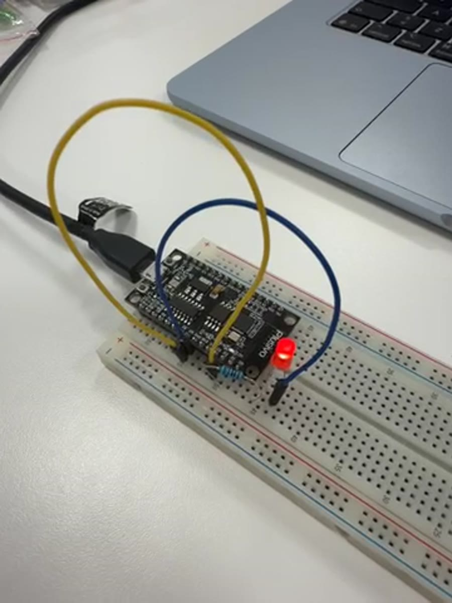
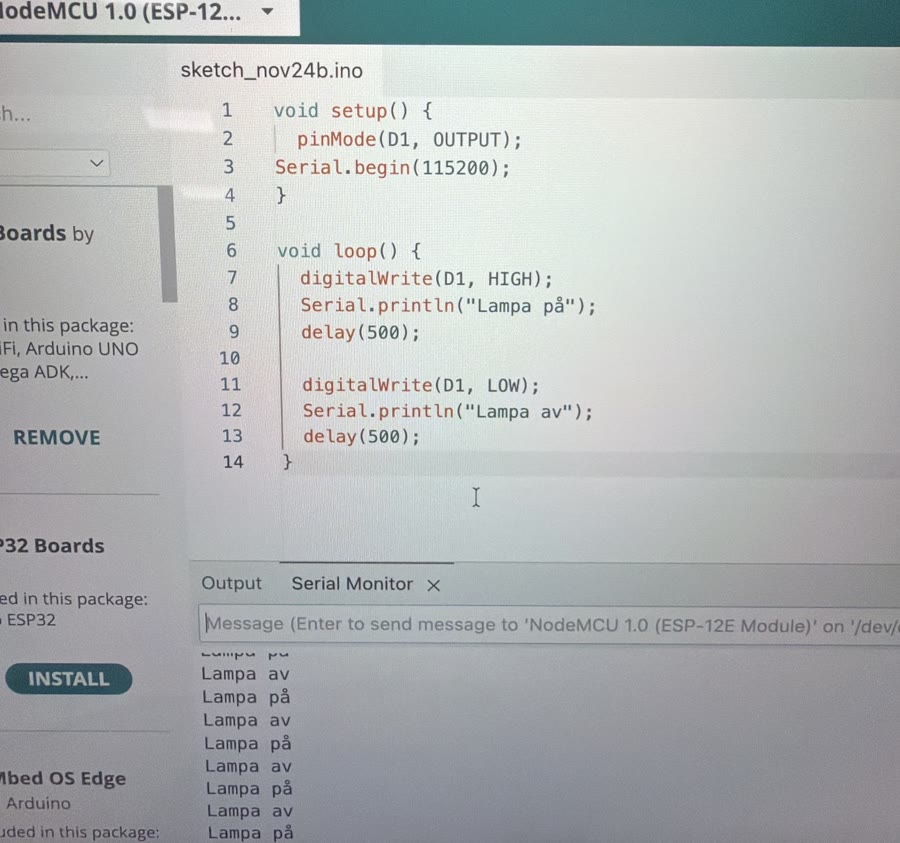

# Min första blinkande lampa med NodeMCU



## Översikt
**Målet:** få en lampa att tändas och släckas av sig själv, om och om igen.

Det jag använde:
- ett NodeMCU-kort
- en röd lampa (LED)
- ett motstånd på 150 Ω
- en sladd och ett kopplingsdäck
- USB-kabel och programmet Arduino IDE

## Mikroprocessor
**Kortet är en liten dator som kan slå på och av ström när koden säger det.**

Mitt kort heter NodeMCU (märket Plusivo) och har chippet ESP8266.
Det kan också använda WiFi, men det behövdes inte här.


Innan Arduino IDE känner igen kortet måste man:
1. lägga in den här länken under *Preferences → Additional boards manager URLs*
   `http://arduino.esp8266.com/stable/package_esp8266com_index.json`
2. installera **esp8266** i *Boards Manager*
3. välja kortet **NodeMCU 1.0 (ESP-12E Module)**

## Så kopplade jag
**Strömmen måste kunna gå runt, från kortet och tillbaka igen.**


- D1 på kortet → motståndet → lampans långa ben
- lampans korta ben → sladd → GND på kortet

Motståndet minskar strömmen. Utan det kan lampan gå sönder.
Lampan lyser bara åt ett håll, så det långa benet ska vara mot D1.

## Två basfunktionerna i Arduino
**Allt i setup körs en gång. Allt i loop körs om och om igen.**

```cpp
void setup() {
  // körs en gång när kortet startar
}

void loop() {
  // körs hela tiden, gång på gång
}
```

## Portinitialisering
**Innan jag använder en pinne talar jag om vad den ska göra.**

Pinnarna är metallstiften på kortet. Jag vill att D1 ska skicka ut ström:

```cpp
pinMode(D1, OUTPUT);
```

- `OUTPUT` = pinnen skickar ut ström (till exempel till en lampa)
- `INPUT` = pinnen läser av något (till exempel en knapp)

## Koden rad för rad
**HIGH tänder, LOW släcker och delay väntar. Loop gör att det upprepas.**

Hela koden ligger i [blink.ino](blink.ino).

```cpp
void setup() {
  pinMode(D1, OUTPUT);     // D1 ska skicka ut ström
  Serial.begin(115200);    // så att kortet kan skriva till datorn
}

void loop() {
  digitalWrite(D1, HIGH);        // ström på, lampan tänds
  Serial.println("Lampa på");
  delay(500);                    // vänta 0,5 sekunder

  digitalWrite(D1, LOW);         // ström av, lampan släcks
  Serial.println("Lampa av");
  delay(500);                    // vänta 0,5 sekunder
}
```

I Serial Monitor (115200) kunde jag se att koden körde, samtidigt som lampan blinkade:



## Det här gick fel för mig
**De flesta problemen satt i kopplingen, inte i koden.**

- **Fel på Macen:** `bad CPU type in executable`.
  Löstes med Rosetta i Terminal:
  `softwareupdate --install-rosetta --agree-to-license`
- **Den vita lampan lyste inte.** Jag bytte till en röd, som behöver mindre ström.
- **Delarna satt i fel rader.** På kopplingsdäcket har bara hål i samma rad kontakt.
- **Lyser lampan inte alls?** Vänd på den.
